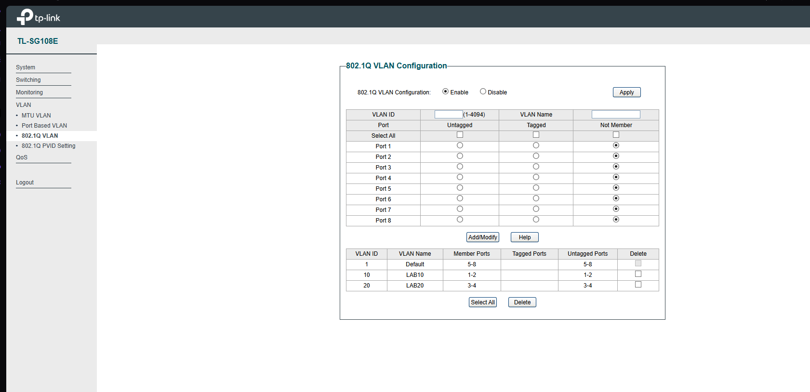
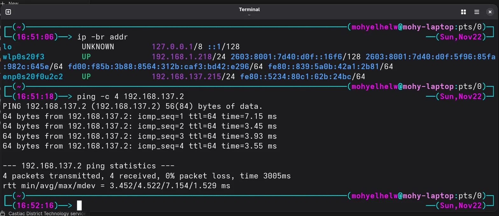
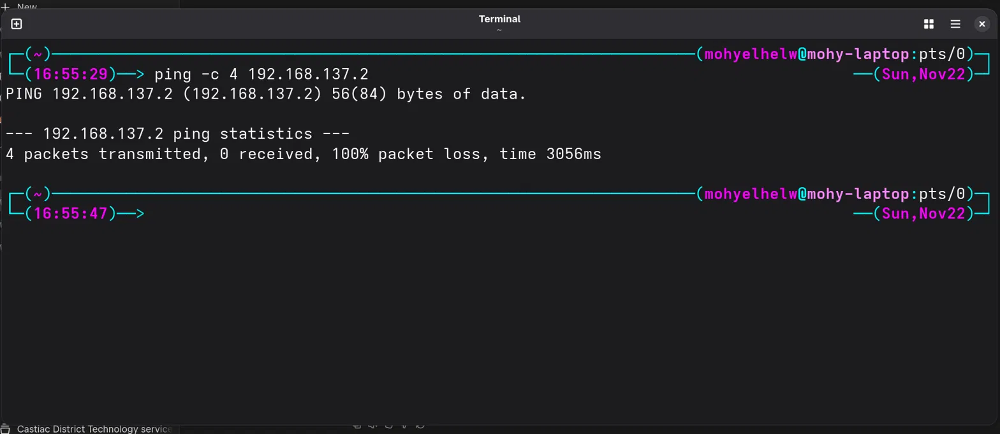

# HW Lab 1 – VLANs on a Physical Switch (TP-Link TL-SG108E)

## Goal
Split one physical switch into three separate networks using 802.1Q VLANs, then prove the isolation with ping tests.

## Hardware
- TP-Link TL-SG108E v6.0 (8-port Easy Smart switch, firmware 20250710)
- Windows PC (port 8)
- Linux laptop with USB Ethernet adapter

## Network Setup
The switch gets internet through my Windows PC using Internet Connection Sharing (ICS):
PC Wi-Fi → PC Ethernet (192.168.137.1) → switch port 8.
The PC acts as the DHCP server and NAT gateway for the 192.168.137.0/24 network.

| Device | IP |
|--------|----|
| PC (gateway) | 192.168.137.1 |
| Switch management | 192.168.137.2 (static) |
| Laptop | 192.168.137.215 (DHCP) |

## VLAN Plan
| VLAN | Name    | Ports | Purpose |
|------|---------|-------|---------|
| 1    | Default | 5–8   | Management (PC on port 8) |
| 10   | LAB10   | 1–2   | Test network A |
| 20   | LAB20   | 3–4   | Test network B |

## Steps
1. Logged into the web UI (default 192.168.0.1, admin/admin) and set a new password.
2. Enabled 802.1Q VLAN.
3. Created VLAN 10 (ports 1–2 untagged) and VLAN 20 (ports 3–4 untagged).
4. Set PVIDs: ports 1–2 → 10, ports 3–4 → 20.
5. Removed ports 1–4 from VLAN 1.
6. Set a static management IP (192.168.137.2) so the address doesn't change after reboots.

Port 8 stayed in VLAN 1 because it's the management VLAN; moving it would lock me out of the switch.



## Cisco Equivalent
An untagged port with a PVID on the SG108E equals an access port on Cisco IOS:
```
interface range fa0/1 - 2
 switchport mode access
 switchport access vlan 10
```

## Testing
Pinged the switch's management IP (192.168.137.2) from the laptop.

| Test | Laptop Port | VLAN | Result |
|------|-------------|------|--------|
| 1 | Port 5 | 1 (same as switch mgmt) | ✅ 4/4 replies, ~4 ms |
| 2 | Port 1 | 10 (isolated) | ✅ 100% packet loss (isolation works) |




## Troubleshooting Notes
- `ping -c 192.168.137.2` failed with "invalid argument". `-c` needs a count: `ping -c 4 ...`.
- After enabling ICS, the switch got a new DHCP address. Found it with a ping sweep plus `arp -a`.
- Saved browser password was tied to the old IP (192.168.0.1), so it didn't autofill at the new address.

## What I Learned
- Untagged + PVID on the SG108E = an access port on Cisco.
- The laptop kept its IP after moving ports, but the VLAN still blocked it: isolation happens at Layer 2, regardless of IP addressing.
- Keep the management port in the management VLAN, or you lose access.
- Windows ICS works as a small router (DHCP + NAT) when you can't cable to the real router.