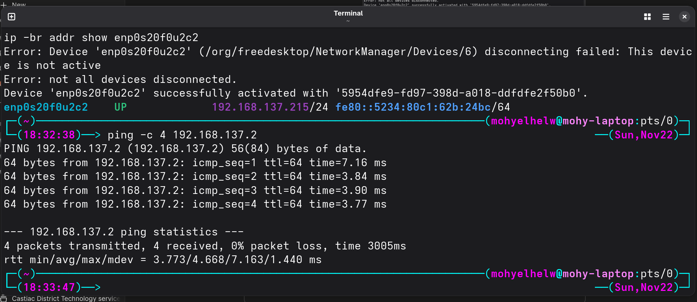
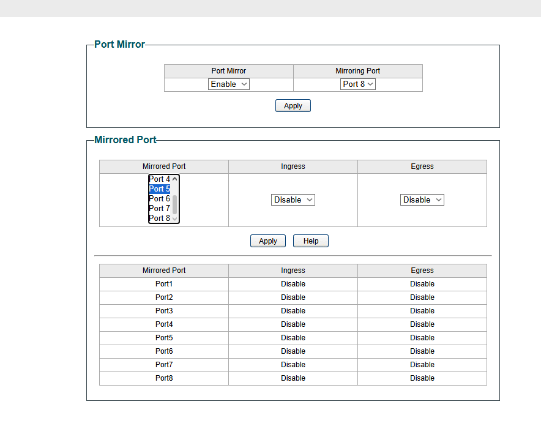
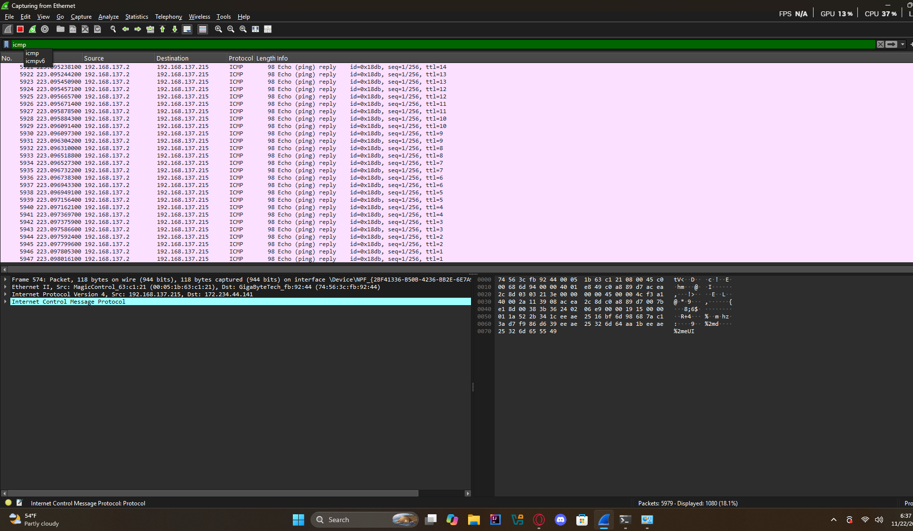
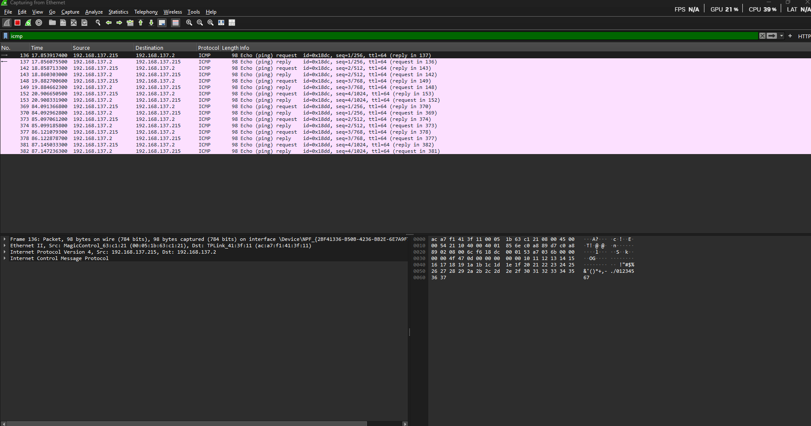
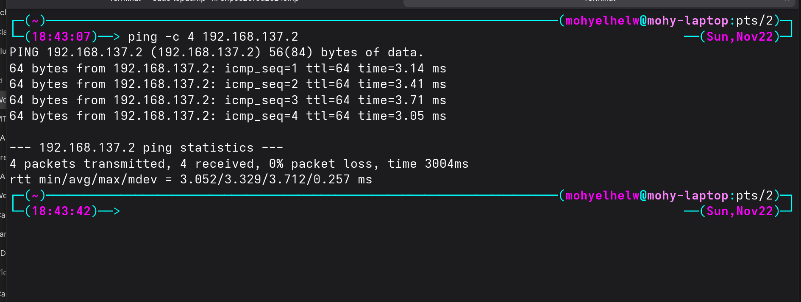
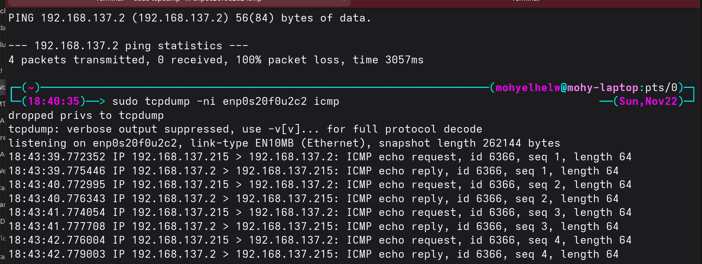

# HW Lab 2 – Port Mirroring and Packet Capture with Wireshark

## Goal
Use port mirroring on a physical switch to capture traffic between two other devices, and see why a switch normally hides that traffic.

## Hardware
- TP-Link TL-SG108E v6.0 (from [HW Lab 1](../hw-01-sg108e-vlans/))
- Windows PC on port 8 running Wireshark 4.6 (with Npcap)
- Linux laptop on port 5 (USB Ethernet adapter)

## Topology
| Device | Port | IP |
|--------|------|----|
| PC (Wireshark, ICS gateway) | 8 | 192.168.137.1 |
| Switch management | — | 192.168.137.2 |
| Laptop | 5 | 192.168.137.215 |

All three are in VLAN 1. The traffic being captured is laptop ↔ switch, which normally never touches port 8.

## Steps

### 1. Baseline: no mirroring
- Started a Wireshark capture on the PC's Ethernet adapter with the display filter `icmp`.
- From the laptop: `ping -c 4 192.168.137.2`
- **Result:** the laptop got 4/4 replies, but Wireshark showed **nothing**.

A switch learns which MAC address lives on which port and only forwards unicast frames to the port they're addressed to. Traffic between port 5 and the switch never reaches port 8. (A hub would have flooded it everywhere.)




### 2. Enabled port mirroring
Monitoring → Port Mirror on the switch:

| Setting | Value |
|---------|-------|
| Port Mirror | Enable |
| Mirroring port (destination) | Port 8 (PC) |
| Mirrored port (source) | Port 5 (laptop), Ingress + Egress |



*(Screenshot taken before setting Ingress/Egress to Enable for port 5.)*

Cisco IOS equivalent (SPAN):
```
monitor session 1 source interface fa0/5 both
monitor session 1 destination interface fa0/8
```

### 3. Unexpected result: a routing loop
With mirroring on, four pings produced **over 1,000 ICMP packets** in Wireshark. The same reply (seq=1) appeared again and again with the **TTL dropping by 1 each time** (14, 13, 12 … 1). The laptop's ping also failed.



**Cause:** the PC was also running Windows Internet Connection Sharing (ICS), which turns on IP routing.
1. The switch mirrored the laptop's ping reply to the PC.
2. Windows saw a packet addressed to 192.168.137.215 and **routed it back out** the same interface, decrementing the TTL.
3. That re-sent packet passed through port 5, so the switch mirrored it to the PC again.
4. Repeat until TTL = 0.

A falling TTL is the giveaway: only routers decrement TTL, so the packet was being routed in a circle.

**Fix:** turned off ICS on the PC during the capture so it stopped routing.

**Lesson:** a mirror (SPAN) destination should be a passive capture device, never a host that forwards traffic. In production, mirror ports go to dedicated monitoring tools for this reason.

### 4. Clean capture
With ICS off, the same ping showed exactly **4 requests and 4 replies**, all with TTL 64.



The Ethernet header shows the PC captured a conversation it wasn't part of:
```
Src: MagicControl_63:c1:21 (laptop USB adapter)
Dst: TPLink_41:3f:11 (switch)
```

## The Same Ping from Three Places
| Where | Tool | What it shows |
|-------|------|---------------|
| Laptop | `ping -c 4 192.168.137.2` | 4/4 replies, ~3 ms |
| Laptop NIC | `sudo tcpdump -ni enp0s20f0u2c2 icmp` | Every request and reply on the wire |
| PC (port 8) | Wireshark + port mirror | The laptop ↔ switch conversation, seen by a third device |




## Reverse Mirroring: Laptop Captures the PC
Flipped the mirror so the laptop could watch the PC's port.

| Setting | Value |
|---------|-------|
| Mirroring port (destination) | Port 5 (laptop) |
| Mirrored port (source) | Port 8 (PC), Ingress + Egress |

Before enabling it, checked that the laptop would not route the mirrored copies:
```
$ sysctl net.ipv4.ip_forward
net.ipv4.ip_forward = 0
```

Then captured on the laptop with `sudo tcpdump -ni enp0s20f0u2c2 icmp` while the PC pinged the switch.

**Result:** the laptop saw the PC ↔ switch pings, a conversation it wasn't part of. Each request and reply appeared **exactly once**, with no loop, even with ICS still running on the PC.


**Why there was no loop this time:** with `ip_forward = 0`, Linux drops packets that aren't addressed to it instead of forwarding them. The PC, with ICS on, had routing enabled and sent every mirrored copy back out. Same switch feature, different destination host, opposite outcome.

**Bonus OS clue:** the PC's pings showed **length 40** (Windows sends 32 bytes of data by default), while the laptop's Linux pings were **length 64** (56 bytes of data). Combined with the starting TTL (Windows 128, Linux 64), packet size is another quick way to tell which OS sent a packet.

## Troubleshooting Notes
- **Npcap install broke ICS.** Installing Wireshark upgraded Npcap, which reset the network adapters. The laptop stopped getting a DHCP address (only an `fe80::` link-local showed in `ip -br addr`). Fixed by unchecking and re-checking sharing on the PC's Wi-Fi adapter, then `nmcli device connect` on the laptop.
- **ICS "select a connection" error.** Re-enabling sharing requires picking the home networking adapter (Ethernet) in the dropdown.
- **Laptop ping failed briefly after the loop**, even though Wireshark showed the switch replying out port 5. `tcpdump` on the laptop helped narrow it down. After `sudo ip neigh flush` and a short wait it recovered, most likely leftover state from the loop's duplicate packets expiring.

## What I Learned
- Switches forward unicast frames only to the destination port, so you can't sniff other devices' traffic without port mirroring.
- Port mirroring copies a port's traffic to another port for analysis (Cisco calls it SPAN).
- TTL is a loop detector: a value that keeps dropping on the same packet means something is routing it in a circle.
- Never mirror traffic to a device that routes. It will forward the copies and create a loop.
- OS fingerprinting hint: Windows starts packets at TTL 128, Linux-based devices at TTL 64.
- Whether a mirror destination loops depends on the host: check `ip_forward` (Linux) or whether ICS/routing is on (Windows) first.
- Capturing at both ends (tcpdump on the host, Wireshark via mirror) quickly shows whether a problem is on the wire or inside the host.

## Cleanup
- Port mirroring → Disable
- Re-enabled ICS on the PC so devices on the switch have internet again
