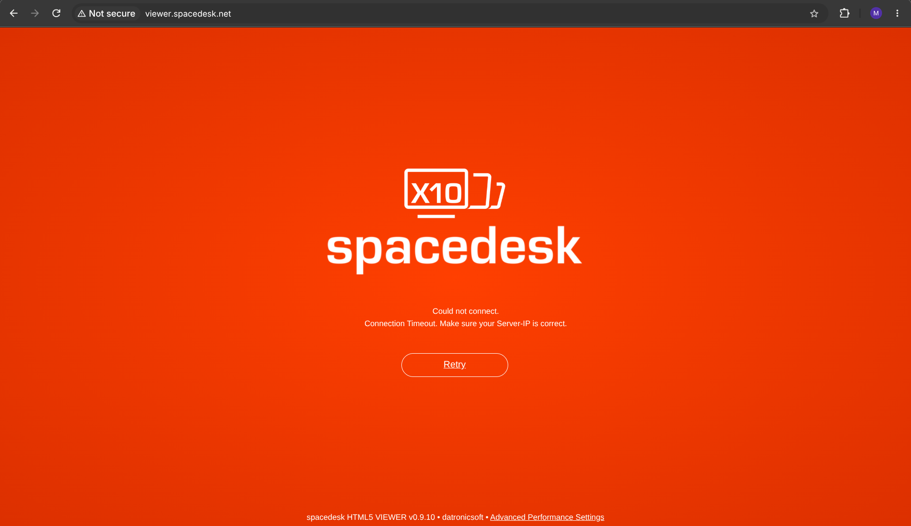
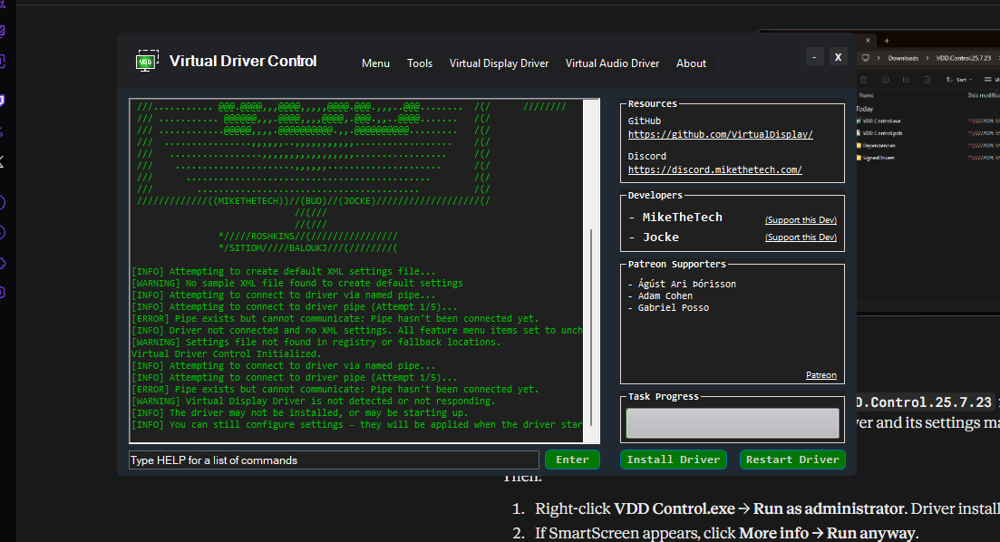
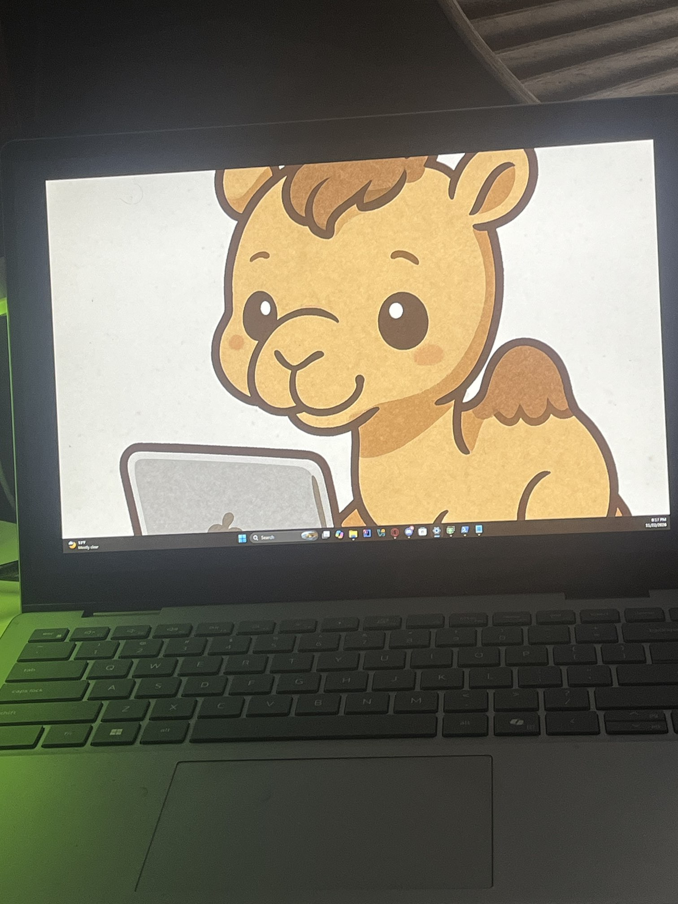

# HW Lab 3 – Laptop as an Extended Second Monitor over the Switch

## Goal
Use my Linux laptop as a third monitor for my Windows PC, extending the desktop (not mirroring it), with all traffic over the wired network through the TL-SG108E.


## Hardware & Software
| Device | Role | Details |
|--------|------|---------|
| Windows 11 PC (RTX 4060) | Host | Port 8, 192.168.137.1, two physical monitors |
| Fedora laptop | Client / extra screen | Port 5, 192.168.137.215 (DHCP via ICS), 3072×1920 panel |
| TP-Link TL-SG108E | Switch | VLAN 1, gigabit |

| Software | Where | Purpose |
|----------|-------|---------|
| Virtual Display Driver (VDD) 25.7.23 | PC | Creates a fake monitor so Windows can *extend* to it |
| Sunshine | PC | Captures and encodes a display (NVENC on the RTX 4060) |
| Moonlight (Flatpak) | Laptop | Receives the stream and sends keyboard/mouse back |

## How It Works
```
Windows desktop ──► Virtual display (DISPLAY5, "VDD by MTT")
                           │
                    Sunshine captures it, encodes with NVENC
                           │
                PC Ethernet ── switch port 8 ── port 5 ── laptop
                           │
                    Moonlight decodes and shows it full-screen
```
Windows thinks a real third monitor is plugged in. Sunshine streams only that monitor, so the laptop acts like an extra screen to the right of my two physical monitors.

## Attempt 1: spacedesk (failed)
spacedesk has a Windows driver and an HTML5 browser viewer, which seemed ideal for a Linux laptop.

1. Installed the spacedesk Windows driver (v2.2.35). It listened on the Ethernet adapter.
2. Opened the HTML5 viewer (`http://viewer.spacedesk.net`, Beta v0.9.10) on the laptop.

| Browser | Result |
|---------|--------|
| Firefox | `E002 – Could not create Websocket` (Firefox is officially unsupported) |
| Chrome | `Connection Timeout` |
| Chrome with Local Network Access flags disabled | Still timed out |

**Troubleshooting:**
- `nc -zv 192.168.137.1 28252` → **Connected**, so the port was open and Windows Firewall was *not* the problem.
- That pointed to the browser side: a public `http://` site trying to open a WebSocket to a private IP, which modern browsers increasingly block.
- Likely root cause: the HTML5 viewer is an old beta (0.9.x) that may not be compatible with the 2.x driver.



**Security note:** spacedesk was also listening on my home Wi-Fi interface with password protection off, so anyone on the Wi-Fi could have connected. I uninstalled it after deciding not to use it.

## Attempt 2: Sunshine + Moonlight + Virtual Display Driver (worked)

### Phase 1: mirror the main screen
1. Installed Sunshine on the PC: `winget install LizardByte.Sunshine`
2. Web UI at `https://localhost:47990` (self-signed certificate warning is expected).
   - Forgot the existing login, so reset it with `sunshine.exe --creds <user> <pass>` and `Restart-Service SunshineService`.
3. Allowed Sunshine through Windows Firewall on **Public** networks (the ICS Ethernet adapter is an "Unidentified network" = Public profile).
4. Installed Moonlight on the laptop: `flatpak install flathub com.moonlight_stream.Moonlight`
5. Paired with a 4-digit PIN entered in Sunshine's **PIN** tab.

**Result:** the laptop showed and controlled my main monitor.

### Phase 2: extend instead of mirror
1. Installed **Virtual Display Driver** with *VDD Control* (run as administrator → Install Driver).
2. Windows Display settings now showed **3 displays**. Set display 3 to **Extend**.



3. Pointed Sunshine at the virtual display.

**Gotcha: `\\.\DISPLAY5` didn't work.** `dxgi-info.exe` listed the virtual display as `\\.\DISPLAY5`, but Sunshine kept streaming my main monitor. The log showed why:
```
Capture size : 1920x1080
Offset       : 800x0      ← that's DISPLAY1, the primary monitor
```
Current Sunshine versions expect the **device_id** in the *Display Id* field, not the display name. The log (Troubleshooting → Logs) lists every display:
```json
{
  "device_id": "{9acddf6d-…}",
  "display_name": "\\\\.\\DISPLAY5",
  "friendly_name": "VDD by MTT",
  "resolution": { "width": 800, "height": 600 },
  "refresh_rate": 30
}
```
Using the `{…}` device_id fixed it.

4. Fixed the virtual display's defaults (800×600 @ 30 Hz) to **1920×1080 @ 60 Hz**.

### Custom resolution attempt
The laptop panel is 16:10 (3072×1920, found with `xrandr`), so 1920×1080 leaves thin black bars. Added 16:10 modes to `C:\VirtualDisplayDriver\vdd_settings.xml`:
```xml
<resolution>
  <width>1920</width>
  <height>1200</height>
  <refresh_rate>60</refresh_rate>
</resolution>
```
then restarted the driver. Moonlight also has its own stream resolution setting, which has to match. I decided to stay at 1920×1080 since the bars are small and the stream is lighter.

## Result


The laptop is a working third monitor: windows can be dragged onto it, it has its own taskbar, and keyboard/mouse work from either machine. Traffic stays on the wired switch network.

## Troubleshooting Notes
| Symptom | Cause | Fix |
|---------|-------|-----|
| Moonlight showed PC "Offline" | Sunshine restarting after a config change | Waited / `Restart-Service SunshineService` |
| `localhost:47990` refused | Used `http://` | Sunshine's UI is **https** only |
| Sunshine login unknown | Credentials from an earlier install | `sunshine.exe --creds` |
| Laptop still showed main monitor | Display name instead of device_id | Use `{device_id}` from the Sunshine log |
| Choppy virtual display | VDD default 30 Hz | Set 60 Hz in Advanced display |

## What I Learned
- **Mirroring vs. extending:** streaming tools capture an existing display. To *extend*, Windows needs another display, which a virtual display driver (or an HDMI dummy plug) provides.
- **Test the network layer first.** `nc -zv` proved the port was open, which ruled out the firewall and pointed to the browser.
- **Logs beat guessing.** Sunshine's log showed exactly which display it captured (capture size + offset) and listed the correct IDs.
- **Windows network profiles matter:** an "Unidentified network" is treated as Public, so firewall rules for Private-only apps silently fail.
- **Check what a service listens on.** spacedesk exposed my screen on home Wi-Fi without a password by default.
- Hardware encoding (NVENC on the RTX 4060) makes low-latency streaming over gigabit Ethernet practical.
