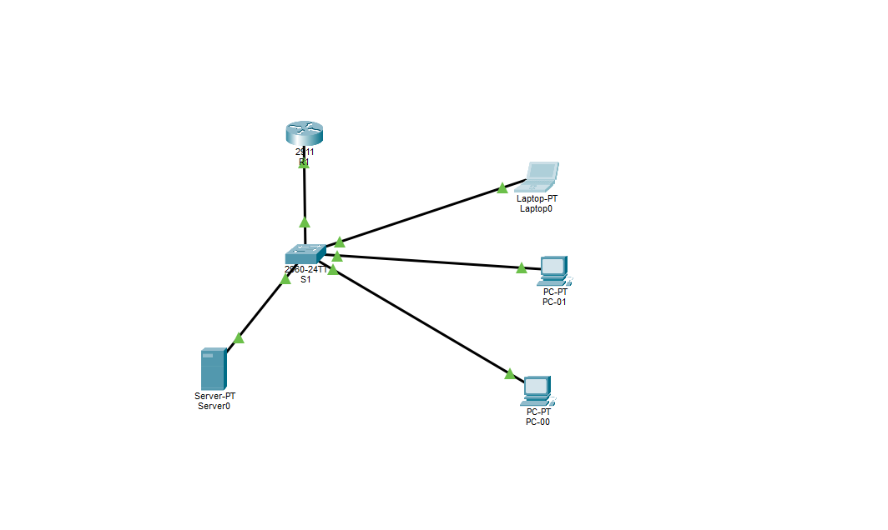
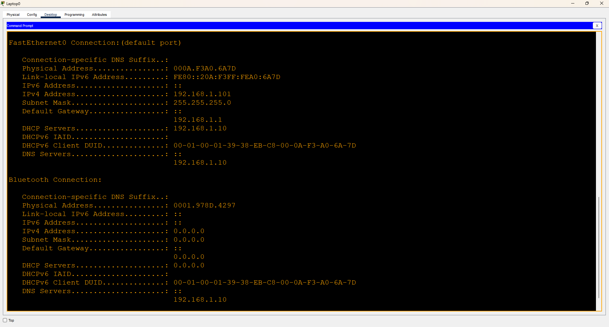
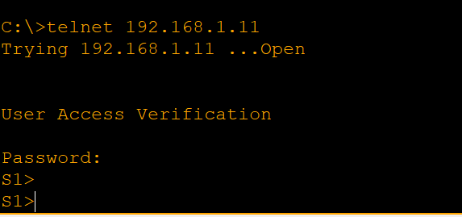

# Lab 1 – Basic LAN with DHCP and Secured Device Access

A small office LAN built in Cisco Packet Tracer: one router, one switch, two PCs, a laptop and a server. Clients get their IP settings automatically from a DHCP server, and the switch is managed remotely over its own management IP with password-protected access.



## Devices

| Device | Model | Role |
|---|---|---|
| R1 | Cisco 2911 | Default gateway for the LAN |
| S1 | Cisco 2960-24TT | Access switch, managed through VLAN 1 |
| Server0 | Server-PT | DHCP server (and DNS server, used in a later lab) |
| PC-00, PC-01, Laptop0 | PC-PT / Laptop-PT | DHCP clients |

## Addressing plan (192.168.1.0/24)

| Device | Interface | IP address | How it's assigned |
|---|---|---|---|
| R1 | G0/0 | 192.168.1.1 | Static |
| Server0 | Fa0 | 192.168.1.10 | Static |
| S1 | VLAN 1 (SVI) | 192.168.1.11 | Static |
| Laptop0 | Fa0 | 192.168.1.101 | DHCP |
| PC-01 | Fa0 | 192.168.1.102 | DHCP |
| PC-00 | Fa0 | 192.168.1.103 | DHCP |

Static devices (gateway, server and switch) use addresses below .100, and the DHCP pool starts at .101, so the two ranges never overlap.

## Configuration

### Router (R1)
```
hostname R1
enable secret <password>
service password-encryption
interface g0/0
 ip address 192.168.1.1 255.255.255.0
 no shutdown
line con 0
 password <password>
 login
line vty 0 15
 password <password>
 login
```

### Switch (S1)
```
hostname S1
enable secret <password>
service password-encryption
interface vlan 1
 ip address 192.168.1.11 255.255.255.0
 no shutdown
ip default-gateway 192.168.1.1
line con 0
 password <password>
 login
line vty 0 15
 password <password>
 login
```

### DHCP server (Server0 → Services → DHCP)
| Setting | Value |
|---|---|
| Pool name | serverPool |
| Default gateway | 192.168.1.1 |
| DNS server | 192.168.1.10 |
| Start address | 192.168.1.101 |
| Subnet mask | 255.255.255.0 |
| Maximum users | 154 (.101 to .254, leaving out the .255 broadcast address) |

Real passwords are not included in this repo.

## Verification

| Test | Command | Result |
|---|---|---|
| Client received DHCP settings | `ipconfig /all` on Laptop0 | IP .101, gateway .1, DHCP server .10, DNS .10 |
| Reach the gateway | `ping 192.168.1.1` | 4/4 replies |
| Reach another client | `ping 192.168.1.102` | 4/4 replies |
| Reach the server | `ping 192.168.1.10` | 4/4 replies |
| Reach the switch management IP | `ping 192.168.1.11` | 4/4 replies |
| Remote access is password-protected | `telnet 192.168.1.11` | Password prompt, then `S1>`; `enable` also asks for a password |
| Switch interfaces | `show ip interface brief` on S1 | Connected ports and VLAN 1 up/up |




## What I learned
- How to plan an address range so static devices and DHCP clients don't overlap.
- A switch needs an IP on a VLAN interface (SVI) and a default gateway before it can be managed remotely.
- Line passwords only take effect with the `login` command, and `service password-encryption` hides them in the running config.
- A DHCP pool must stop before the broadcast address (.255).

## Next steps
- Replace Telnet with SSH, which encrypts the session (Telnet sends passwords in plain text).
- Lab 2: split the network into VLANs with inter-VLAN routing.
