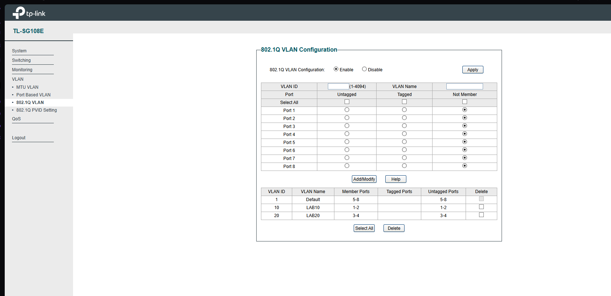

# Lab 2 – VLANs on a Physical Switch (TP-Link TL-SG108E)

## Goal
Split one physical switch into three separate networks using 802.1Q VLANs.

## Hardware
- TP-Link TL-SG108E (8-port Easy Smart switch)
- Windows PC (port 8), Linux laptop

## VLAN Plan
| VLAN | Name    | Ports | Purpose                  |
|------|---------|-------|--------------------------|
| 1    | Default | 5–8   | Management (PC on port 8) |
| 10   | LAB10   | 1–2   | Test network A           |
| 20   | LAB20   | 3–4   | Test network B           |

## Steps
1. Logged into the web UI at 192.168.0.1 (PC set to static 192.168.0.10/24).
2. Enabled 802.1Q VLAN.
3. Created VLAN 10 (ports 1–2 untagged) and VLAN 20 (ports 3–4 untagged).
4. Set PVIDs: ports 1–2 → 10, ports 3–4 → 20.
5. Removed ports 1–4 from VLAN 1.

Port 8 stayed in VLAN 1 because it's the management VLAN; moving it would lock me out of the switch.



## Cisco Equivalent
An untagged port with a PVID on the SG108E equals an access port on Cisco IOS:
```
interface range fa0/1 - 2
 switchport mode access
 switchport access vlan 10
```

## Testing
_Pending, waiting on a second Ethernet cable._
- Same VLAN (port 8 ↔ port 5): expected ping success
- Different VLAN (port 8 ↔ port 1): expected ping failure